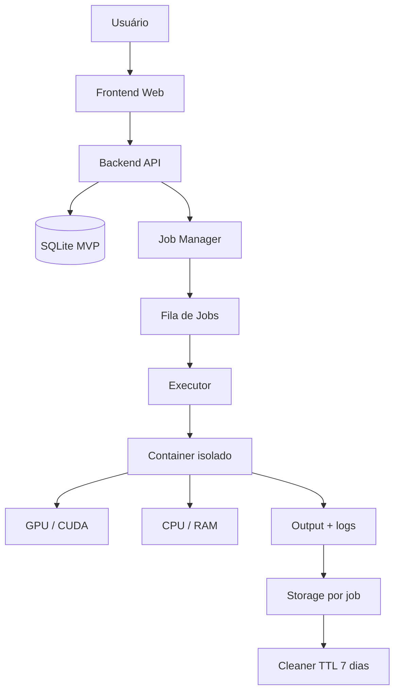

# AI Compute Server

Este repositório organiza a base para uma plataforma local de execução de workloads de IA em uma máquina potente, com isolamento por job, fila de processamento, controle de recursos e retenção temporária de arquivos.

## Objetivo

Construir uma arquitetura local segura e evolutível para receber projetos enviados por usuários, executá-los em ambientes isolados e disponibilizar resultados por uma interface web.

## Visão geral da arquitetura

A abordagem recomendada para o MVP é:

- frontend web para autenticação institucional passwordless, upload e acompanhamento;
- backend API para autenticar, registrar e gerenciar jobs;
- autenticação sem senha (Magic Link / OTP) com restrição estrita de domínio institucional;
- seleção de ambiente restrita a catálogo curado de imagens Docker (Allowlist);
- alocação exclusiva de hardware (CPU/GPU) por job ativo, sem concorrência de recursos;
- time-boxing estrito (tempo máximo definido pelo usuário sob teto global do administrador com auto-kill);
- fila interna inteligente para ordenação e prevenção de inanição (*starvation*);
- executor em containers isolados sem rede e com usuário não-root;
- armazenamento temporário por job com limpeza automática após 7 dias;
- evolução futura com SLURM para cluster e múltiplas máquinas.

## Arquitetura principal



## Segurança

Todos os jobs são tratados como código potencialmente não confiável.

As regras de segurança do MVP incluem:

- autenticação passwordless obrigatória restrita a domínios institucionais autorizados;
- nenhum job executa no host;
- execução restrita a imagens Docker curadas da allowlist (sem imagens ou Dockerfiles arbitrários);
- execução dentro de container isolado com usuário não-root;
- montagem mínima de diretórios (/job/input, /job/workspace, /job/output, /job/logs);
- rede desligada por padrão (--network none);
- alocação exclusiva de recursos controlada pelo administrador;
- time-boxing obrigatório com auto-kill caso exceda o tempo solicitado ou o teto do admin;
- arquivos temporários com retenção máxima de 7 dias.

## Política de retenção

Os dados de um job devem permanecer armazenados por 7 dias e depois serem removidos automaticamente.

## Fases do projeto

1. Arquitetura e requisitos
2. Ambiente base do host
3. Executor isolado
4. Fila e scheduler
5. Backend API
6. Upload e validação do ZIP
7. Banco de dados
8. Frontend
9. Persistência e limpeza
10. Segurança e hardening
11. Monitoramento
12. Testes de robustez

## Estrutura do repositório

```text
.
├── README.md
├── docs/
├── services/
├── infra/
├── storage/
├── db/
├── logs/
├── scripts/
└── .gitignore
```

## Como rodar e testar

- **Servidor:** `python3 services/api/app/server.py` (acesse `http://localhost:8000`)
- **Suíte de Testes Automatizados:**
```bash
python3 services/job-manager/executor/test_job_executor.py && \
python3 services/job-manager/executor/test_docker_isolation.py && \
python3 services/job-manager/queue/test_queue_manager.py && \
python3 services/api/app/test_job_upload.py && \
python3 services/api/app/test_job_store.py && \
python3 services/api/app/test_job_api.py && \
python3 scripts/test_cleanup_jobs.py && \
python3 services/api/app/test_server.py && \
python3 config/test_server_config.py && \
python3 services/api/app/test_etapas_abc.py && \
python3 services/api/app/test_api_security.py
```
- **Guia de Operação e Testes:** Consulte [docs/como-rodar-e-testar.md](docs/como-rodar-e-testar.md) para instruções detalhadas.
- **Estado, pendências e operação completa:** Consulte [docs/status-e-operacao.md](docs/status-e-operacao.md).
- **Manual do Desenvolvedor de IA:** Consulte [docs/manual-do-desenvolvedor-ia.md](docs/manual-do-desenvolvedor-ia.md) para o contrato de entrada e saída (`OUTPUT_DIR`).

Em produção, `DEV_AUTH_MOCK` permanece desativado por padrão. As rotas de jobs exigem
token Bearer válido e somente o proprietário ou um administrador pode consultar logs,
outputs, status, cancelar ou remover um job.

## Status dos Pilares e Funcionalidades

- [x] **Pilar 1 (Autenticação Passwordless):** Restrição estrita a `@academico.ufpb.br`, OTP temporário, Bearer token de sessão de 7 dias, impersonation bloqueada.
- [x] **Pilar 2 (Allowlist de Imagens):** Catálogo gerenciado (`/api/catalog/images`), imagens arbitrárias e Dockerfiles bloqueados.
- [x] **Pilar 3 (Alocação Exclusiva & Time-Boxing):** Recursos do admin, teto máximo de 4h, piso de 60s, cota anti-starvation de 2 jobs por aluno.
- [x] **Resiliência de Boot (Etapa B):** Se o servidor cair, containers Docker continuam na máquina (`--name ai_job_{id}`), outputs e logs são consolidados no retorno e a fila SQLite é recuperada sem jobs órfãos.
- [x] **Cancelamento Ativo (Etapa C):** Endpoint `/api/jobs/{id}/cancel` finaliza o container imediatamente com `docker kill`.
- [x] **Zero dependências externas & sem warnings:** Parser multipart nativo da biblioteca padrão (substituindo o módulo obsoleto `cgi` para total compatibilidade com Python 3.12 e 3.13).

## Observação importante

Este repositório começa pela arquitetura e pela base do projeto. O objetivo é criar uma estrutura segura e organizada para evolução incremental, sem avançar para implementações mais complexas antes da validação da fase anterior.
