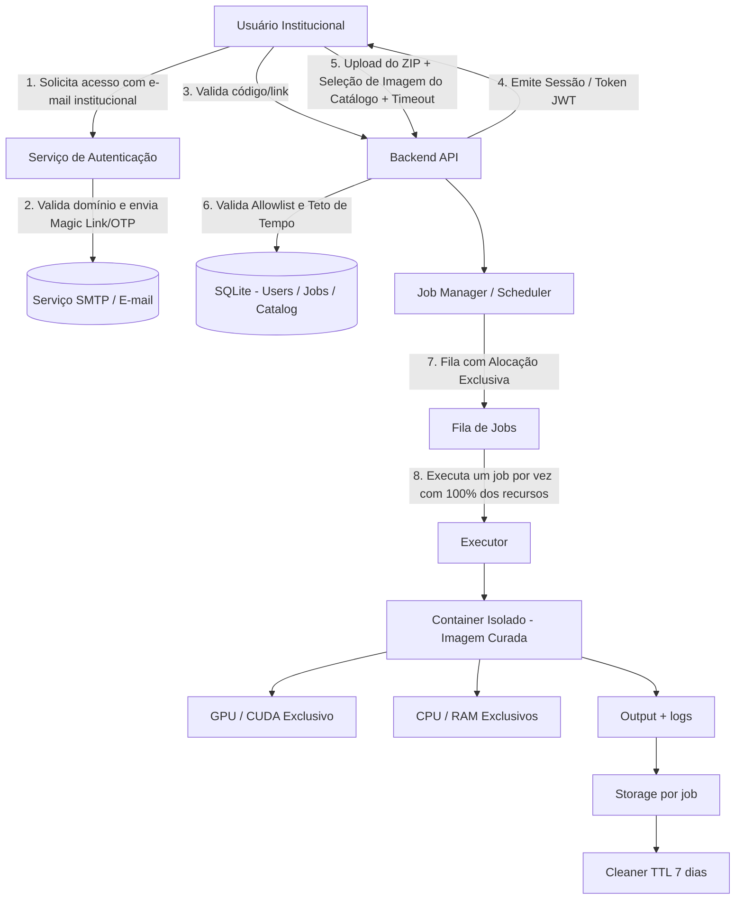

# Arquitetura do MVP

## Objetivo

Definir uma arquitetura segura, simples e evolutível para um servidor local de execução de workloads de IA.

## Decisão arquitetural

Para a plataforma, a solução adota:

- **Autenticação institucional passwordless** (via Magic Link / OTP por e-mail com restrição estrita de domínio);
- **Docker para isolamento dos jobs** com imagens pré-aprovadas (Allowlist curada, sem entrada livre de imagens ou Dockerfiles);
- **Alocação exclusiva de hardware** por job ativo (acesso integral à CPU/GPU do host sem contenção de concorrência);
- **Controle de tempo estrito (Time-Boxing)** com teto máximo global definido pelo administrador;
- **Fila local com escalonamento justo** e limite de jobs pendentes por usuário para evitar inanição (*starvation*);
- **SQLite** para persistência inicial de usuários, tokens de autenticação, catálogo de imagens e jobs;
- **Armazenamento por job separado** com limpeza automática após 7 dias;
- **Evolução futura para SLURM** para múltiplos nós e clusters distribuídos.

A decisão central é: **nenhum código de usuário executa no host**, **nenhuma imagem arbitrária é executada**, e **todo acesso é rastreável a uma identidade institucional verificada**.

## Fluxo principal

## Componentes

### 1. Autenticação e Gestão de Identidades
Responsável por:
- Validar se o e-mail pertence aos domínios institucionais autorizados (ex: `@instituicao.edu.br`);
- Gerar tokens temporários criptografados / OTPs de curta duração (10 a 15 minutos);
- Enviar o link/código via SMTP e validar a entrada do usuário;
- Vincular todas as requisições e jobs criados à identidade autenticada.

### 2. Frontend Web
Responsável por:
- Interface de login passwordless (inserção de e-mail institucional e confirmação de código);
- Upload do arquivo ZIP e definição do entrypoint;
- Seleção visual do ambiente de execução exclusivamente a partir do catálogo aprovado (dropdown gerenciado);
- Definição do tempo máximo de execução pretendido (com exibição clara do teto máximo permitido);
- Visualização de status em tempo real, streaming de logs e download de resultados.

### 3. Backend API
Responsável por:
- Autenticar e autorizar cada chamada;
- Validar o payload do ZIP (segurança de arquivos, descompactação segura);
- Validar se a imagem escolhida pertence à allowlist de imagens aprovadas;
- Validar e aplicar o teto de tempo (time-boxing);
- Aplicar cotas por usuário (ex: impedir que um único usuário sature a fila com múltiplos jobs longos);
- Registrar jobs no SQLite e expor logs e outputs.

### 4. Job Manager & Scheduler Exclusivo
Responsável por:
- Orquestrar a fila de execução garantindo **alocação exclusiva** (apenas 1 job ativo por vez alocando os recursos totais de GPU/CPU);
- Prevenir *starvation* priorizando usuários que ainda não executaram tarefas recentemente (política Fair-Share simples);
- Despachar o próximo job para o Executor.

### 5. Executor & Container Isolado
Responsável por:
- Montar o ambiente isolado do job (`/job/input`, `/job/workspace`, `/job/output`, `/job/logs`);
- Injetar variáveis de ambiente padrão (`OUTPUT_DIR`, `WORKSPACE_DIR`, `JOB_ID`);
- Lançar o container com a imagem da allowlist sem rede (`--network none`) e com usuário não-root;
- Monitorar ativamente o tempo limite (timeout) e forçar encerramento imediato caso ultrapassado.

## Segurança

A arquitetura assume que o código enviado pelo usuário é potencialmente malicioso. Por isso:

- o trabalho nunca roda diretamente no host;
- o volume do job é montado somente com leitura no input e gravação em workspace/output;
- a execução usa usuário não-root;
- a rede é isolada por padrão;
- CPU, RAM e GPU são limitados;
- o sistema remove o ambiente do job após a conclusão ou falha.

## Escolha do MVP

### Por que Docker + fila local

- simples de implementar e manter;
- compatível com um host Linux único;
- adequado para entorno local e acadêmico;
- muito mais fácil de operar do que um cluster completo no início;
- atende aos requisitos de segurança e isolamento com menos complexidade.

### Quando migrar para SLURM

Migrar para SLURM faz sentido quando:

- houver várias máquinas;
- houver necessidade de partições de recursos;
- a fila precisar de escalonamento mais formal;
- houver mais de uma GPU ou cluster de execução.

## Critérios de sucesso do MVP

- cada job executa em ambiente isolado;
- o host não expõe diretórios sensíveis;
- a fila respeita a ordem de chegada;
- logs e status são registrados;
- arquivos são removidos após 7 dias;
- o sistema falha com segurança e não compromete a máquina hospedeira.

## Riscos que persistem

Mesmo com Docker, alguns riscos permanecem:

- falhas no kernel;
- vulnerabilidades no runtime do container;
- problema com o driver NVIDIA;
- falha na configuração de namespaces e recursos;
- má configuração de rede ou de cgroups.

Por isso, a arquitetura da segurança precisa ser tratada como defesa em profundidade.
