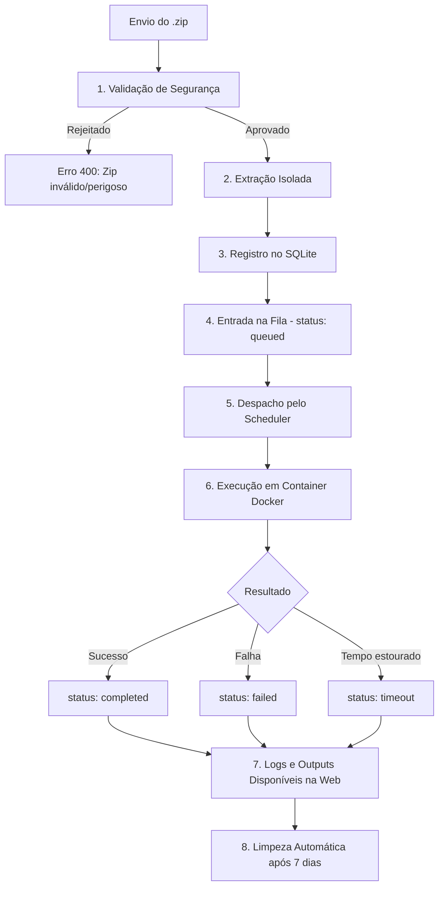

# Guia de Operação: Como Rodar, Testar e o Ciclo de Vida dos Jobs

Este documento explica como executar o servidor, rodar todos os testes automatizados e detalha o fluxo completo de um projeto desde o envio do arquivo ZIP até a geração e limpeza dos resultados.

---

## 1. Como Rodar os Testes

Para garantir que todos os módulos (executor, fila, validador de upload, banco SQLite, script de retenção de 7 dias e API HTTP) estão funcionando corretamente, execute o comando único abaixo na raiz do repositório:

```bash
python3 services/job-manager/executor/test_job_executor.py && \
python3 services/job-manager/executor/test_docker_isolation.py && \
python3 services/job-manager/queue/test_queue_manager.py && \
python3 services/api/app/test_job_upload.py && \
python3 services/api/app/test_job_store.py && \
python3 services/api/app/test_job_api.py && \
python3 scripts/test_cleanup_jobs.py && \
python3 services/api/app/test_server.py && \
python3 services/api/app/test_etapas_abc.py && \
python3 services/api/app/test_api_security.py
```

Se todos passarem, cada módulo exibirá `OK`. Os testes HTTP de segurança confirmam que
as rotas de jobs rejeitam requisições sem autenticação.

---

## 2. Como Subir o Servidor

O servidor HTTP integrado não necessita de nenhuma biblioteca externa instalada (utiliza a biblioteca padrão do Python 3.12).

Para iniciar a API e a Interface Web:

```bash
python3 services/api/app/server.py
```

* O servidor iniciará por padrão em: **`http://localhost:8000`**
* Para alterar porta ou host, use variáveis de ambiente:
  ```bash
  PORT=9000 HOST=127.0.0.1 python3 services/api/app/server.py
  ```

Abra o seu navegador em `http://localhost:8000` para acessar o painel de controle.

---

## 3. Como Enviar o Arquivo (ZIP) do Projeto

### O que deve conter o arquivo ZIP?
O arquivo `.zip` deve conter o código do seu modelo de IA e arquivos necessários. Por exemplo:
```text
meu_projeto.zip
├── main.py              <-- Script principal (entrypoint)
├── requirements.txt     (opcional)
└── dataset_amostra.csv  (opcional)
```

> **Atenção às regras do seu código Python**:
> - O script executará dentro do diretório `/job/workspace`.
> - Se o seu script salvar resultados, salve-os na pasta `/job/output` (ex: `with open('/job/output/resultado.txt', 'w') as f:` ou relativo `../output/`).

---

### Opção A: Pelo Navegador (Interface Web)

1. Acesse `http://localhost:8000`.
2. No card **Novo Job de IA**:
   * **Arquivo**: Arraste seu `.zip` para a caixa pontilhada ou clique para selecionar.
   * **Entrypoint**: Digite o nome do script (ex: `main.py`).
   * **Imagem Docker**: Selecione uma imagem disponível no catálogo aprovado.
   * **Limites**: Configure CPU (ex: `1.0`), RAM (ex: `512m`) e GPUs (`0` para CPU, `1` para GPU).
   * **Timeout**: Tempo limite em segundos (padrão: `300`).
3. Clique no botão **Criar e Enfileirar Job**.

---

### Opção B: Pelo Terminal (cURL / API)

Você também pode submeter via linha de comando:

```bash
curl -X POST http://localhost:8000/api/jobs/upload \
  -F "file=@meu_projeto.zip" \
  -F "entrypoint=main.py" \
  -F "image=python:3.12-slim" \
  -F "cpu_limit=1.0" \
  -F "memory_limit=512m" \
  -F "gpu_count=0" \
  -F "timeout_seconds=300"
```

---

## 4. O Que Acontece Depois? (Ciclo de Vida do Job)

Assim que o arquivo é enviado, o sistema realiza as seguintes etapas automáticas:



### Passo a Passo Detalhado:

1. **Validação de Segurança Rigorosa (`job_upload.py`)**:
   * O sistema analisa os bytes do ZIP antes de descompactar.
   * **Bloqueios de segurança**: rejeita arquivos maiores que 100 MB, arquivos com *path traversal* (como `../../etc/passwd`), links simbólicos (*symlinks*), arquivos ocultos e arquivos excessivamente compactados (*zip bomb*).

2. **Criação do Espaço Isolado do Job (`storage/jobs/<job_id>`)**:
   * É gerado um ID único (ex: `job_20261116_142725_d86805`).
   * Cria-se uma árvore de diretórios exclusiva:
     * `input/`: arquivos de entrada protegidos somente-leitura.
     * `workspace/`: onde o código do `.zip` é descompactado.
     * `output/`: pasta onde o modelo salva pesos, gráficos e predições.
     * `logs/`: onde fica gravado o arquivo `job.log`.
     * `metadata/`: metadados da execução em formato JSON.

3. **Persistência no SQLite (`db/jobs.db`)**:
   * O job é salvo no banco com status `queued`, timestamps e a data exata de expiração (`expires_at = data_atual + 7 dias`).

4. **Entrada na Fila de Execução (`queue_manager.py`)**:
   * O job entra na fila ordenada por ordem de chegada (FIFO).

5. **Execução Automática e Isolada no Container Docker (`job_executor.py`)**:
   * O servidor possui um **Worker em background** que monitora a fila continuamente. Assim que um job chega (seja enviado pelo host ou por outro computador na rede), o worker pega o job automaticamente na ordem de chegada (FIFO).
   * O status vai automaticamente para `running`.
   * O container é lançado com **isolamento extremo**:
     * Sem privilégios de root (`--user 1000:1000`, `--cap-drop=ALL`).
     * Sem acesso à rede do host (`--network none`).
     * Sistema de arquivos do container em modo leitura (`--read-only`), com apenas `/tmp` temporário em memória.
     * Limites rígidos de CPU e RAM configurados via cgroups.
     * O container **não tem acesso** aos arquivos do computador host nem ao Docker socket.

6. **Finalização e Coleta**:
   * O container encerra e é destruído automaticamente (`--rm`).
   * Toda a saída do terminal do script é salva em `logs/job.log`.
   * O status no SQLite é atualizado para `completed`, `failed` (se o script deu erro de sintaxe/exceção) ou `timeout` (se excedeu o tempo limite).

7. **Acesso aos Resultados**:
   * Na interface web, o status muda automaticamente.
   * Você clica no botão **Logs** para abrir o terminal no navegador e ver o que o script imprimiu.
   * Você clica no botão **Output** para visualizar e fazer download dos arquivos gerados pelo script.

8. **Retenção e Limpeza Automática (TTL 7 dias)**:
   * Periodicamente, o script `scripts/cleanup_jobs.py` varre o sistema.
   * Jobs com mais de 7 dias têm seus arquivos em `storage/jobs/<job_id>` excluídos com segurança, e o status no banco é atualizado para `expired`.
